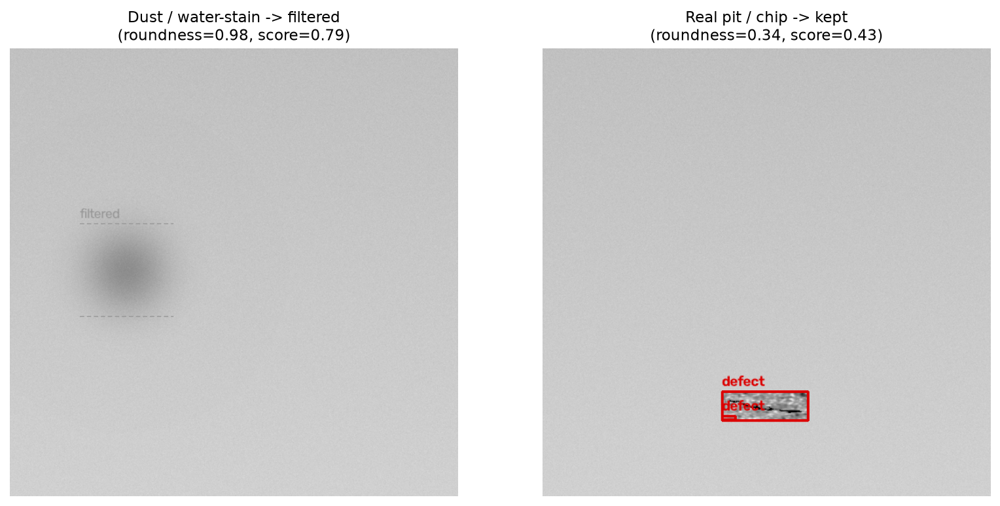
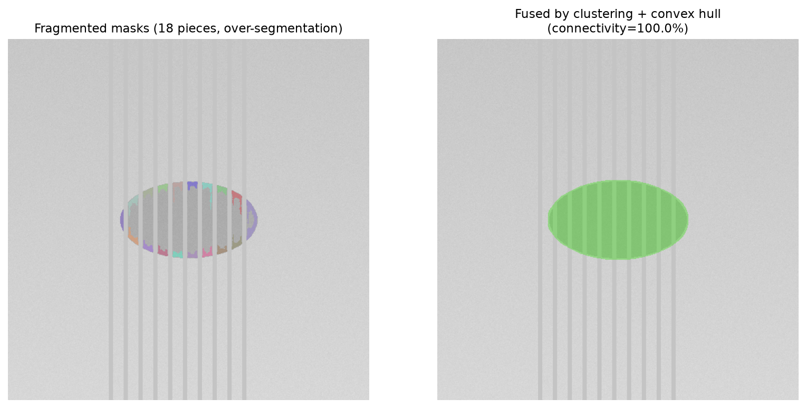
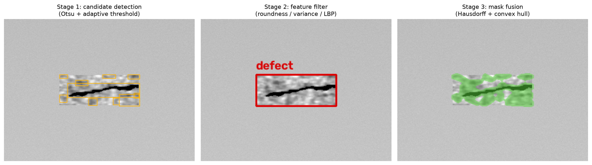

# Industrial Defect Inspection · 工业盖板缺陷抗干扰检测


面向手机盖板玻璃产线的机器视觉缺陷检测系统。核心解决产线 AOI 中
**飘浮微尘、水渍、镜头污渍与防伪条纹**等干扰项被分割模型误报为缺陷的问题，
通过「多特征初筛 → 碎片掩膜融合 → 视觉大模型（VLM）终审」三级流水线，
在不增加昂贵算力的前提下显著压低误报率，并保证真实缺陷（凹坑 / 崩边 / 划痕）不漏检。

项目包含完整的**算法模块、FastAPI 服务、Web 控制台、合成数据生成器、吞吐量压测与
136 项自动化测试**，开箱即可运行；无需下载模型权重即可跑通全部测试与演示。

---

## 效果一览

多特征初筛：高圆度、内部均匀的粉尘/水渍被滤除，低圆度、边缘锐利的真实裂纹被保留。



碎片掩膜融合：防伪条纹把目标分割成 18 个碎片，经聚类 + 凸包缝合为完整轮廓。



完整三级流水线（候选检测 → 特征初筛 → 掩膜融合）。



---

## 一、问题背景

在玻璃盖板表面检测中，分割模型（如 SAM）对暗斑敏感，但产线环境中的粉尘、水渍、
镜头污渍与产品自带的防伪条纹同样会产生深色区域，导致大量误报，实测误报率可达
十几个百分点。直接把所有暗斑送大模型复核成本过高、节拍也不满足。本项目的思路是
**用低成本几何/纹理特征先过滤掉绝大多数明显干扰，把模糊样本再交给 VLM 做终审**：

1. **多特征初筛（FeatureFilter）**：对候选区域提取圆度、长宽比、灰度方差、LBP 纹理
   对比度，用加权评分快速排除规则、均匀、边缘模糊的粉尘/水渍；
2. **碎片掩膜融合（SAMCombiner）**：对被防伪条纹切碎的掩膜，用 Hausdorff 距离聚类、
   形态学闭运算与凸包（Convex Hull）把同属一个目标的碎片缝合为完整轮廓；
3. **VLM 终审（VLMValidator）**：仅当评分落在模糊区间（0.45–0.75）时，裁切 ROI 送入
   本地视觉大模型（Ollama `qwen2.5vl:7b`）做最终判定，超时自动降级，不阻塞主流程。

---

## 二、核心算法

### 1. 多特征干扰评分

对每个候选 ROI 计算：

- **圆度 Roundness** = `4π·A / P²`（对轮廓凸包计算，抗边缘锯齿），粉尘近圆、缺陷不规则；
- **灰度方差 VarGray**：粉尘内部均匀、缺陷内部深浅不一；
- **LBP 纹理对比度**：基于 uniform-LBP 直方图熵，粉尘纹理均匀、缺陷边缘锐利。

干扰评分：

```
Score = 0.4 · Roundness + 0.3 · (1 − VarGray) + 0.3 · ContrastLBP
```

采用「多证据与」硬闸门 + 软闸门兜底：只有同时满足高圆度、低方差、低纹理复杂度且总分
超阈值才判为干扰，并辅以长宽比闸门剔除贯穿画面的栅栏线，避免误杀细长划痕。

### 2. 碎片掩膜融合

对分割出的多个碎片，用 Hausdorff 距离与质心距离做聚类，对同一目标的碎片取并集后做
凸包填充，恢复被条纹遮挡的完整轮廓，并以**最大连通域占比**量化掩膜连通度。

### 3. 视觉大模型终审

只把少量边界样本送 VLM，显著降低推理开销；VLM 服务不可用时按规则结果降级，
保证检测链路始终可用。

---

## 三、目录结构

```
industrial-defect-inspection/
├── backend/
│   └── app.py                # FastAPI 后端（检测/配置/压测/统计，端口 8562）
├── frontend/                 # 纯 HTML/JS/CSS 工业风控制台（端口 8522）
├── detector/
│   └── feature_filter.py     # 多特征初筛（圆度/方差/LBP + 评分 + 长宽比闸门）
├── segmenter/
│   └── sam_combiner.py       # 碎片聚类、Hausdorff 距离、凸包融合、连通度
├── vlm/
│   └── validator.py          # Ollama 视觉大模型终审（含超时降级）
├── data/
│   ├── synthetic_generator.py# 合成数据生成（粉尘/缺陷/条纹，无需外部数据）
│   └── synthetic/            # 生成的 .npz（已 gitignore，首次运行自动生成）
├── scripts/
│   ├── benchmark_line_speed.py # 产线节拍压测（时延/P95/FPS）
│   └── make_demo_figures.py    # 生成 README 效果图
├── tests/                    # pytest 自动化测试（136 项）
├── weights/                  # SAM 权重位置（可选，见该目录 README）
├── docs/                     # 技术规格书、数学模型、吞吐量报告
├── assets/                   # README 效果图
├── config.py                 # 端口/阈值/评分权重/验收口径统一配置
├── requirements.txt
├── run_backend.bat / run_frontend.bat / start_all.bat
└── conftest.py
```

---

## 四、快速开始

### 环境准备

- Python 3.9+（推荐 3.10/3.11）
- 纯 CPU 可运行；有 GPU 时真实 SAM / VLM 更快

```bash
git clone https://github.com/LuMing1225/industrial-defect-inspection.git
cd industrial-defect-inspection

python -m venv .venv
# Windows
.venv\Scripts\activate
# Linux / macOS
# source .venv/bin/activate

pip install -r requirements.txt
```

### 运行测试（无需任何权重 / 数据集）

测试启动时若 `data/synthetic/` 为空，会自动生成 512×512 的合成基准集
（100 张缺陷 + 50 张粉尘 + 30 张条纹），随后执行全部断言：

```bash
python -m pytest tests/ -q
```

覆盖：粉尘排除率、真实缺陷漏检、碎片连通度、特征/评分公式、VLM 接口、
单帧时延与端到端流水线。

### 启动 Web 演示

```bash
# Windows 一键启动（同时拉起前后端并打开浏览器）
start_all.bat

# 或分别启动
python -m uvicorn backend.app:app --host 0.0.0.0 --port 8562   # 后端
python -m http.server 8522 -d frontend                           # 前端
```

浏览器打开 http://localhost:8522 ，后端 Swagger 文档：http://localhost:8562/docs 。

### 生成效果图 / 压测

```bash
python scripts/make_demo_figures.py          # 重新生成 assets/ 下的效果图
python scripts/benchmark_line_speed.py --duration 30 --fps 10
```

---

## 五、数据与权重说明

### 合成数据（默认）

默认不依赖任何外部数据集：`data/synthetic_generator.py` 程序化生成三类样本——
高斯模糊的近圆粉尘/水渍、带尖角与裂纹的真实缺陷（划痕/崩边）、以及被竖条纹切割的
防伪标掩膜。这些样本特征可复现、可量化，用于回归测试与演示。

### 接入真实缺陷数据集（可选）

若提供 [KolektorSDD](https://www.vicos.si/resources/kolektorsdd/) 表面缺陷数据集，
可通过环境变量接入，缺陷样本会改用真实缺陷 patch：

```bash
# Windows PowerShell
$env:KOLEKTOR_SDD_DIR="C:\path\to\KolektorSDD"
# Linux / macOS
export KOLEKTOR_SDD_DIR=/path/to/KolektorSDD
```

### SAM 权重（可选）

默认 `use_real_sam=False`，碎片分割回退到 OpenCV 连通域实现，聚类/距离/凸包逻辑与真实
SAM 完全一致，接口与测试不受影响。需要真实分割效果时，下载 `sam_vit_b.pth` 放入
`weights/` 并打开开关，详见 [`weights/README.md`](weights/README.md)。

---

## 六、HTTP 接口

| 方法 | 路径 | 说明 |
|---|---|---|
| GET | `/api/health` | 健康检查（后端、Ollama、GPU 状态） |
| GET / POST | `/api/config` | 查看 / 热更新阈值与评分权重 |
| POST | `/api/detect` | 上传图片（`multipart/form-data`，字段 `file`），返回检测结果与标注图 |
| POST | `/api/benchmark` | 触发节拍压测，返回平均/P95 时延与吞吐 |
| GET | `/api/stats` | 历史检测统计（内存态） |

`/api/detect` 返回每级流水线的候选数量、各候选的特征与评分、掩膜连通度、VLM 结论，
以及各级耗时（毫秒）与 base64 标注图。

---

## 七、指标与口径

| 指标 | 内置合成基准集结果 / 设计目标 |
|---|---|
| 粉尘/水渍干扰排除率 | ≥ 96%（合成集断言通过） |
| 真实缺陷漏检 | 合成集 100 张缺陷全部检出（含细长划痕） |
| 碎片掩膜连通度 | ≥ 92% |
| 初筛 + 掩膜融合耗时 | 设计目标 ≤ 80 ms/帧（10 Hz 节拍） |
| VLM 终审耗时 | 设计目标 ≤ 450 ms/帧，仅处理模糊样本 |

> 说明：以上是**内置可复现合成基准集上的断言结果与工程设计目标**。真实产线在光照、
> 相机、产品批次上存在差异，落地时需要用现场采集的图像重新标定阈值（评分权重、圆度/
> 方差门限、Hausdorff 距离等），这些参数集中在 `config.py`，前端也支持在线热调。

---

## 八、技术栈

- **算法**：OpenCV（连通域、自适应阈值、形态学、距离变换、凸包）、scikit-image（LBP）、
  scikit-learn；可选 Segment Anything（ViT-B）
- **服务**：FastAPI + Uvicorn，原生 HTML/JS/CSS 前端
- **大模型**：Ollama + Qwen2.5-VL（本地部署，超时降级）
- **工程**：pytest、NumPy 合成数据、吞吐量压测、统一配置中心

更多设计细节见 `docs/` 目录下的技术规格书、特征判定数学模型与吞吐量报告。

---

## License

[MIT License](LICENSE) © 2026 LuMing
